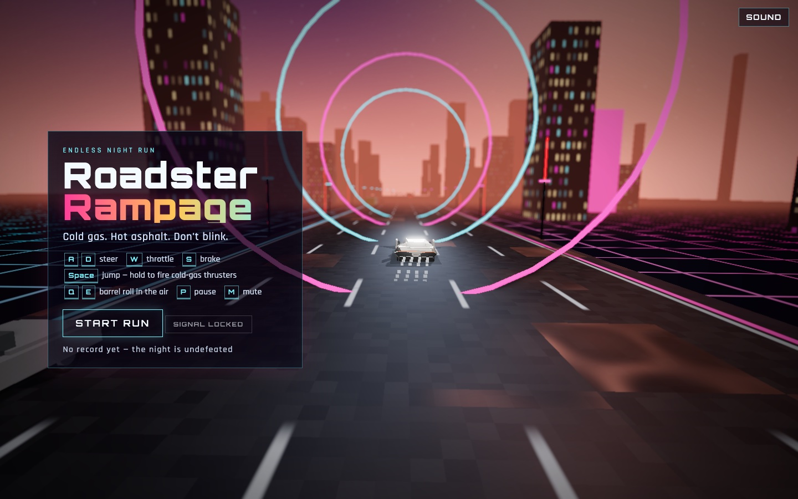
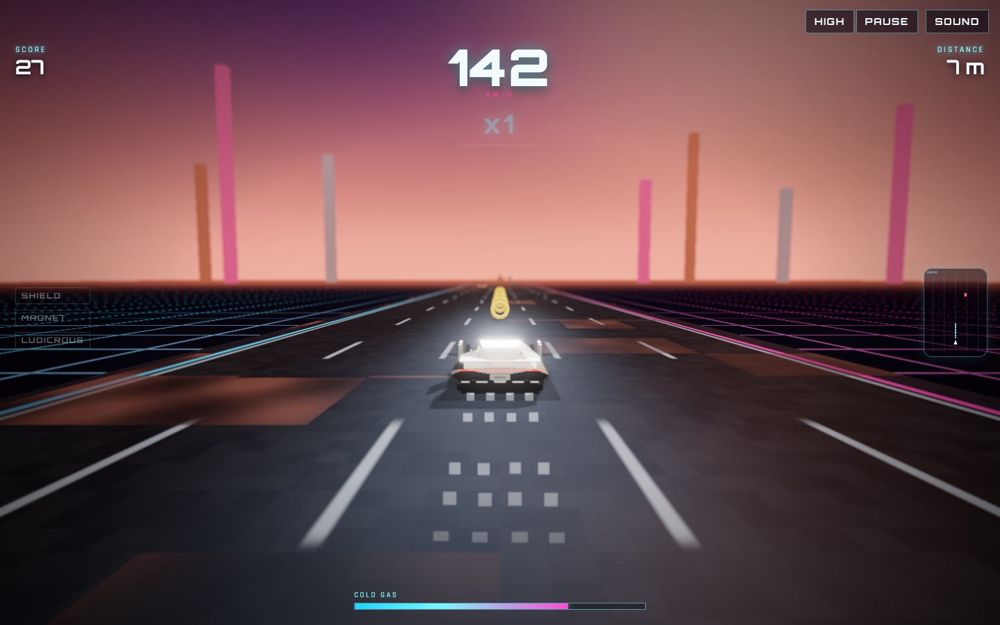

<div align="center">

# ROADSTER RAMPAGE

### Cold gas. Hot asphalt. Don't blink.

An endless synthwave highway, a supercar with thrusters, and one more run.
<br />
Built in TypeScript and Three.js. Play with a keyboard or touch controls.

[](https://github.com/stanleycyang/roadster-rampage/actions/workflows/ci.yml)


**[Start driving](#get-on-the-road) · [Make it yours](#make-it-yours) · [Contribute](#build-the-next-mile) · [Report a bug](https://github.com/stanleycyang/roadster-rampage/issues/new)**



</div>

## Five lanes. One more run.

Weave through traffic. Vault a bus. Hold jump to fire your cold-gas thrusters, then roll through the air to keep the combo alive. The road keeps going. Your luck might not.

Roadster Rampage is a browser arcade game with an original car, a procedural city, and a synthesized soundtrack built in code. No account or backend is needed to play; your best score, distance, and combo stay in your browser.

| On the road | In the air | After dark |
| :--- | :--- | :--- |
| Dodge cars, trucks, and buses across five lanes. Stack near misses and collect coins. | Jump traffic, hold to glide, and barrel roll for style points. Manage your boost to stick the landing. | Chase combos through rain, neon tunnels, police pursuits, and a changing sunset-to-night sky. |

Pick up shields, magnets, and boost canisters. Hit **Ludicrous Mode** to slow time and turn up the glow. A crash gets a slow-motion replay, a scorecard, and a reason to try again.



## Get on the road

You need **Node.js 24 LTS**, npm, and a browser with **WebGL 2** and hardware acceleration enabled.

```bash
git clone https://github.com/stanleycyang/roadster-rampage.git
cd roadster-rampage
nvm use # If you use nvm; otherwise install Node.js 24 first.
npm ci
npm run dev
```

Open **[localhost:47331](http://localhost:47331)** and hit **Start run**.

### Know your controls

| Action | Keyboard | Touch |
| :--- | :--- | :--- |
| Steer | `A` / `D` or `←` / `→` | Left / Right |
| Throttle | `W` or `↑` | Gas |
| Brake | `S` or `↓` | Brake |
| Jump → hold to glide | `Space` | Hold Jump |
| Barrel roll in the air | `Q` / `E`, or tap steer | Tap steer |
| Pause / resume | `P` or `Esc` | Pause / Resume |
| Mute | `M` | Sound |
| Graphics quality | High / Medium button | High / Medium button |

**Your car cruises automatically.** Use throttle to close a gap, brake to line up a vault, and steering to move while airborne.

**Need a lighter ride?** Switch to Medium. High adds ambient occlusion, depth of field, and sharper shadows; Medium keeps the lighting and bloom. The game also lowers quality automatically when rendering slows down.

## Make it yours

Fork the repo, clone your fork, and pick a part of the highway to change. The game uses TypeScript, Three.js, Vite, CSS, and the Web Audio API. Cars and scenery are assembled in code, so you can change their shape without a modeling tool.

| Want to change… | Start here |
| :--- | :--- |
| Jump height, gravity, boost, lanes, or combo timing | [`src/config.ts`](src/config.ts) |
| Traffic, collisions, pickups, or road events | [`src/sim.ts`](src/sim.ts) |
| The player car and its appearance | [`src/car.ts`](src/car.ts) |
| Cars, trucks, and buses | [`src/vehicles.ts`](src/vehicles.ts) |
| Skyline, road, environment, or lighting | [`src/world.ts`](src/world.ts) |
| Screen effects and shaders | [`src/shaders.ts`](src/shaders.ts) · [`src/fx.ts`](src/fx.ts) |
| Music, engine sound, or effects | [`src/audio.ts`](src/audio.ts) |
| Keyboard and touch controls | [`src/input.ts`](src/input.ts) |
| Menus, HUD, or mobile layout | [`src/ui.ts`](src/ui.ts) · [`src/style.css`](src/style.css) · [`index.html`](index.html) |
| Game flow, camera, replay, or rendering passes | [`src/game.ts`](src/game.ts) |

<details>
<summary><strong>Developer shortcuts & camera views</strong></summary>

Open `http://localhost:47331/?debug` to enable these shortcuts:

| Key | Effect |
| :--- | :--- |
| `L` | Activate Ludicrous Mode |
| `G` | Give the player a shield |
| `B` | Refill boost |
| `N` | Advance 4,000 meters |
| `K` | Trigger a rocket launch |

For car screenshots, use `?shot=front`, `?shot=side`, or `?shot=rear`. These views hide the interface. Use `?autostart` to skip the title screen.

</details>

## Build the next mile

A better first jump, a clearer button, or a faster frame can make the whole game feel better. Contributions can be small. A useful bug report counts, too.

**Good places to start:**

- **Game feel:** tune a mechanic and explain how the change affects a run.
- **Performance:** profile a slow device, share measurements, and improve a bottleneck.
- **Accessibility:** improve keyboard focus, contrast, instructions, or motion options.
- **Worldbuilding:** experiment with traffic, scenery, weather, or road events.
- **Documentation:** clarify setup or add a helpful screenshot or troubleshooting note.

These are suggested directions, not promised features. For a large feature or visual overhaul, [open an issue](https://github.com/stanleycyang/roadster-rampage/issues/new) first so the approach can be discussed.

### Send a pull request

1. Fork the repository and create a branch for your change.
2. Keep the change focused and follow the surrounding code style.
3. Run `npm run build`, then `npm run preview` to test the production output.
4. Check start/restart, steering, jump/glide, pause/resume, sound, and quality. Check a narrow viewport and touch controls when changing the interface.
5. Open a PR explaining **what changed, why, and how you tested it**. Include before/after screenshots for visual changes and measurements for performance changes.

GitHub Actions checks the production build on pushes and pull requests. There is no automated gameplay test suite yet; describe your browser checks in the PR.

### Found a rough edge?

[Open a bug report](https://github.com/stanleycyang/roadster-rampage/issues/new) with your browser, OS/device, graphics setting, steps to reproduce, and what you expected. A screenshot or console error helps. Never include credentials or private data.

## Ship your own highway

```bash
npm run build    # Type-check and generate dist/
npm run preview  # Serve the production build locally
```

The output is a static site. On **Vercel**, import your fork and leave Root Directory at the repository root. [`vercel.json`](vercel.json) configures Vite, `npm ci`, `npm run build`, and `dist`; [`package.json`](package.json) selects Node.js 24. No environment variables are required.

Push to your Vercel project's production branch to deploy. Test the resulting URL on desktop and mobile. To require CI before merging, configure the production build check in your repository's branch protection settings.

<details>
<summary><strong>Troubleshooting</strong></summary>

- **The game cannot start:** enable hardware acceleration and check that your browser supports WebGL 2. Try updating the browser or graphics driver.
- **Frame rate is low:** choose Medium quality and try a smaller browser window.
- **No sound:** click or tap the game to unlock browser audio, then check the Sound button.
- **Port 47331 is occupied:** stop the other server or run `npm run dev -- --port 47332`.
- **A deployment fails:** run `npm ci` and `npm run build` on Node.js 24, then inspect the first build error. Make sure Vercel is deploying the commit containing your fix.

</details>

## Credits & licensing

Rendering by [Three.js](https://threejs.org/), tooling by [Vite](https://vite.dev/), and type checking by [TypeScript](https://www.typescriptlang.org/). The interface uses Orbitron and Rajdhani via Google Fonts. The car, city, and soundtrack are original and built in code.

A project license has not been selected yet. See this section for an update before redistributing the project or incorporating its code into another project. Third-party dependencies retain their own licenses.

---

<div align="center">

**Take a run. Find a rough edge. Make the next run better.**

[Fork Roadster Rampage](https://github.com/stanleycyang/roadster-rampage/fork) · [Share an idea](https://github.com/stanleycyang/roadster-rampage/issues/new) · [Browse the code](src)

</div>
